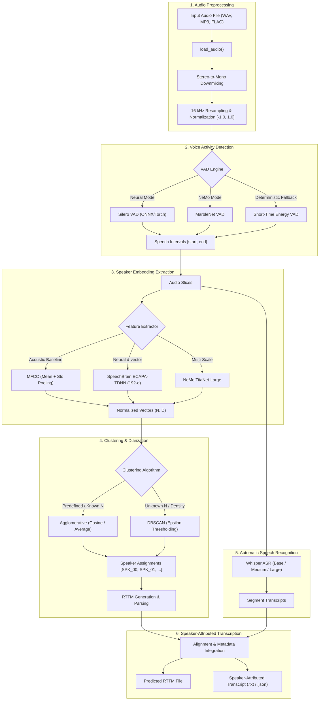

# Architecture & System Design

This document details the architectural design, algorithmic distinctions, and component interaction of the Speech Diarization and ASR toolkit.

---

## 1. Pipeline Overview

The system addresses the combined challenge of **Speaker Diarization** ("Who spoke when?") and **Automatic Speech Recognition (ASR)** ("What was said?"), unifying them into **Speaker-Attributed Transcription**.

---

## 2. Neural vs. Acoustic Baseline Diarization

A critical architectural distinction in this repository is between **Classical Acoustic Feature Clustering** and **Deep Neural Speaker Diarization**:

| Characteristic | Classical Baseline (MFCC + Clustering) | Neural Diarization (ECAPA-TDNN / NeMo TitaNet) |
| :--- | :--- | :--- |
| **Feature Representation** | 13–20 MFCCs with temporal mean & standard deviation pooling | 192-d (ECAPA) or 512-d (TitaNet) deep embeddings trained on speaker identification |
| **Speaker Discriminability** | Low: Sensitive to phonetic content, pitch, and recording noise | High: Invariant to linguistic content, highly sensitive to vocal tract anatomy |
| **Short Segment Robustness** | Poor: Short words skew statistical averages | Robust: Embeddings remain stable down to 0.5s segments |
| **Computational Footprint** | Extremely lightweight (pure CPU/NumPy, microseconds) | Requires GPU acceleration or neural inference latency |
| **Primary Use Case** | Exploratory baseline, local embedded fallback, offline tests | Production multi-speaker meetings, telephonic conversations |

---

## 3. Voice Activity Detection (VAD)

Three complementary VAD approaches are supported:
1. **Silero VAD**: Pretrained recurrent model trained on extensive multilingual speech corpora. Excellent speech/noise discrimination with configurable speech padding and minimum speech duration thresholds.
2. **NeMo MarbleNet**: Deep 1D time-channel separable convolutional architecture optimized for low-latency streaming and offline speech detection.
3. **Energy-Based VAD**: Rule-based Short-Time Energy (STE) with zero-crossing thresholding. Fully deterministic, self-contained, requiring zero external dependencies or model weights.

---

## 4. Evaluation Protocol

Performance validation is grounded in standardized speech metrics:
- **Diarization Error Rate (DER)**: Calculated adhering to NIST RT specifications:
  $$\text{DER} = \frac{\text{Missed Speech} + \text{False Alarm} + \text{Speaker Error}}{\text{Total Reference Speech Time}}$$
  A forgiveness collar (default: $0.25\text{ s}$) around speaker turn boundaries accommodates human annotator ambiguity. Optimal global speaker alignment between reference and hypothesis is determined using the Hungarian algorithm (`linear_sum_assignment`).
- **Word Error Rate (WER)**: Evaluated using word-level Levenshtein distance dynamic programming.
- **Real-Time Factor (RTF)**:
  $$\text{RTF} = \frac{\text{Total Wall-Clock Processing Time}}{\text{Total Audio Duration}}$$
  An $\text{RTF} < 1.0$ confirms faster-than-real-time throughput.
